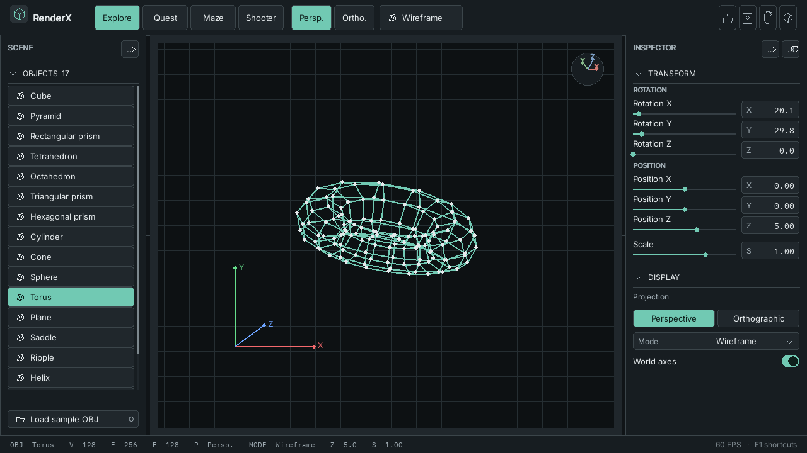
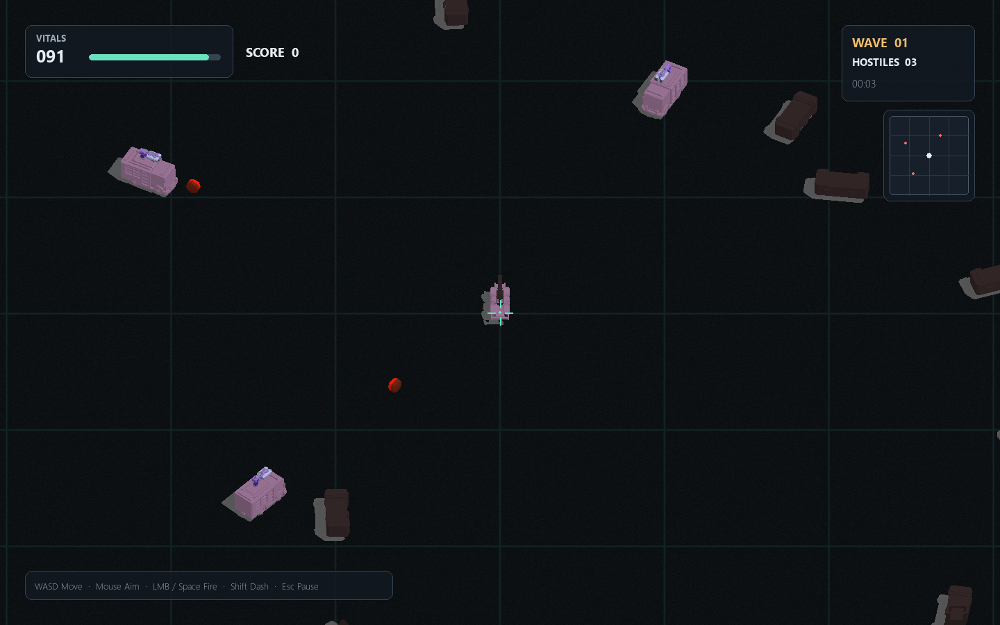
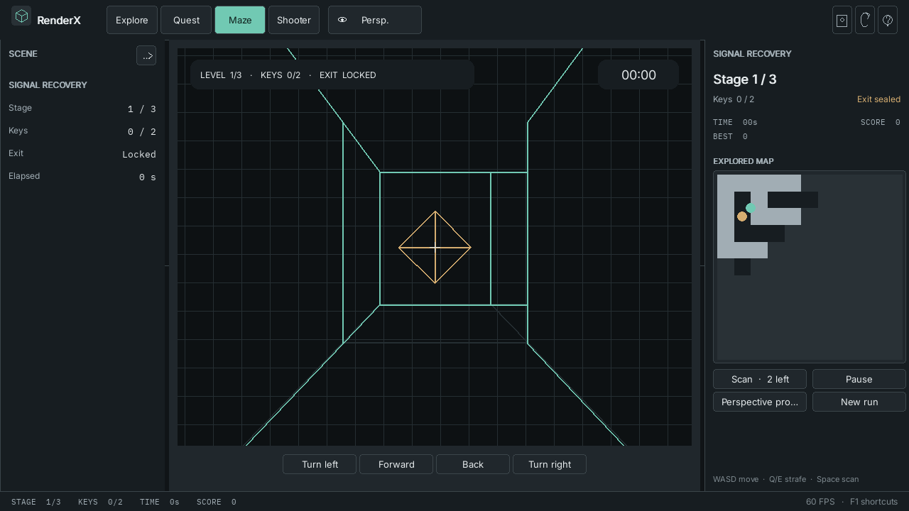
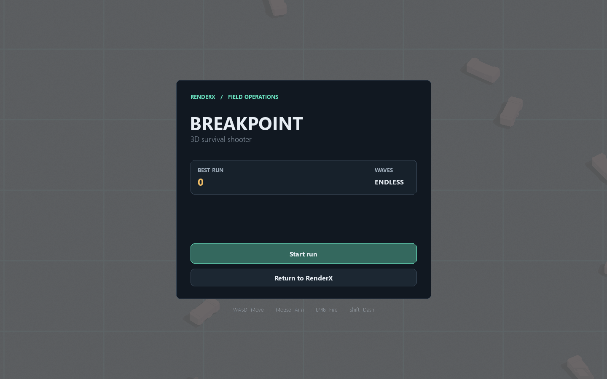

# RenderX

RenderX is a Python 3D graphics app with a custom wireframe and software rasterizer, projection challenges, a first-person maze, and **Breakpoint**, a real-time 3D survival shooter. It opens on a short landing page and enters the Explore workspace by default.

## Modes

- **Explore** — inspect built-in and imported meshes, change transforms and projection, and compare wireframe, hidden-line, solid, and depth rendering.
- **Challenges** — work through short exercises in orientation, depth, and near-plane clipping.
- **Maze** — complete a three-stage first-person wireframe campaign with keys, fog of war, and a live projection toggle.
- **Shooter / Breakpoint** — survive escalating waves in a 3D arena. Scout, striker, bulwark, and wraith vehicles arrive over time, with a three phase Iron Wraith boss every fifth wave. Health kits and timed rapid fire, shield, and overdrive boosts reward smart movement. The game also includes destructible cover, mouse aiming, a dash, a minimap, difficulty settings, and a saved best score.

The application uses a charcoal technical theme with a mineral-teal accent by default. The light theme is available from the header and both choices are remembered. The main window renders at its live pixel size so the interface stays sharp while resizing. Breakpoint opens in a separate resizable OpenGL window and returns to the RenderX screen you came from when **Return to RenderX** is selected.

## Screenshots

| RenderX studio | Breakpoint combat |
|---|---|
|  |  |

| Signal maze | Breakpoint menu |
|---|---|
|  |  |

## Run

Python 3.10 or newer and an OpenGL 3.3 compatible graphics device are required. The dependency list includes the renderer, game, and model-loading libraries.

```powershell
python -m pip install -r requirements.txt
python main.py
```

For development, `python main.py --skip-landing` opens Explore directly.
`python main.py --mode explore|challenge|maze|shooter` opens one destination
directly for focused testing.

## Controls

### Application

| Action | Control |
|---|---|
| Change page | Click a top tab, press `Tab`, or use `Ctrl/Cmd+Alt+1…4` |
| Return to landing | Click the RenderX mark or press `Ctrl/Cmd+Shift+H` |
| Switch theme | Click the sun/moon button in the header |
| Open shortcut reference | `F1` or `?` |
| Move keyboard focus / activate | `F6` / `Enter` |
| Pause a maze or shooter run | `Esc` |
| Exit the application | Close the window |

| Adjust master volume | Drag the `VOL` control in the header or shooter HUD |
| Mute / unmute music | Click the speaker button in the header or shooter HUD |

Volume and music preference are saved between launches. Sound effects follow the master volume; the speaker button only mutes music.

### Breakpoint

| Action | Control |
|---|---|
| Move | `W` `A` `S` `D` or arrow keys |
| Aim | Mouse |
| Fire | Hold left mouse button or `Space` |
| Dash | `Shift` (cooldown applies) |
| Pause / resume | `Esc` |
| Toggle fullscreen | `F11` |

### Maze

| Action | Control |
|---|---|
| Move / turn | `W` / `S` and `A` / `D` or arrow keys |
| Strafe | `Q` / `E` |
| Look | Drag inside the view |
| Projection | `P` |
| Scan nearby cells | `Space` |
| Pause | `Esc` |
| Continue after a stage | `Enter` or `C` |
| New run | `R` |

### Explore

| Action | Control |
|---|---|
| Choose a mesh | Shape picker |
| Rotate / move | Drag, the inspector sliders, or keyboard controls |
| Scale | Mouse wheel or `+` / `-` |
| Set an exact transform | Click a numeric value and type a number |
| Projection / axes | `P` / `X` |
| Load sample OBJ | `O` |
| Reset / screenshot | `R` / `F12` |
| Change render mode | `M` |

## Design

Explore and Challenges use RenderX's own transformation, clipping, projection, and rasterization code. Maze geometry uses the same wireframe path. Breakpoint uses a separate OpenGL 3.3 pipeline for its textured 3D models and real-time combat. The UI uses locally bundled Inter and IBM Plex Mono fonts with their SIL Open Font License texts in `assets/fonts/`.

Shooter code and model assets are adapted from [3D-RPG-Shooter](https://github.com/dev-mojammel-hosain/3D-RPG-Shooter) with project-owner authorization. Its original license and acknowledgement are included in [`renderx/shooter/UPSTREAM.md`](renderx/shooter/UPSTREAM.md).

See [`docs/ARCHITECTURE.md`](docs/ARCHITECTURE.md) for the component boundaries and [`docs/REFERENCES.md`](docs/REFERENCES.md) for project credits.
