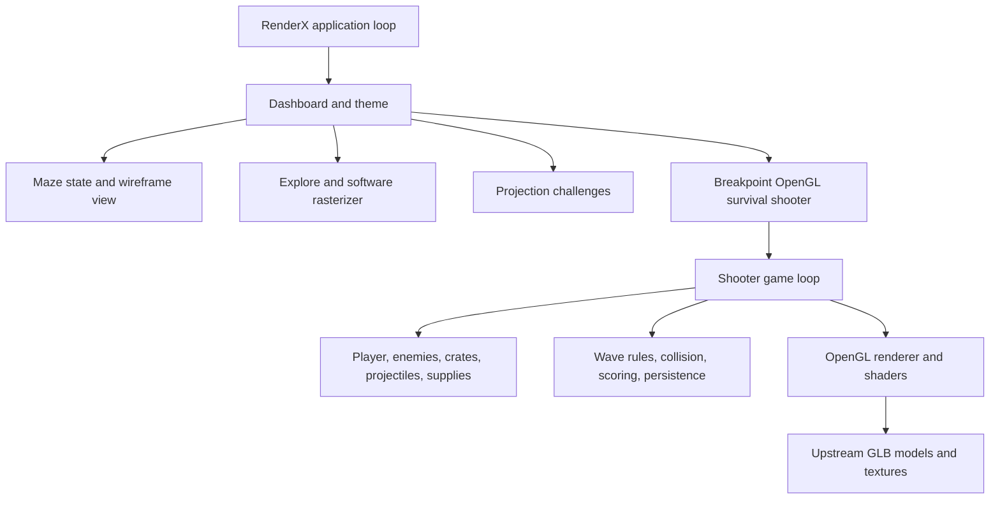

# Architecture

## Application shell

`renderx/app.py` owns the Pygame window, input routing, and frame lifecycle. `renderx/dashboard.py` supplies the four destinations and shared controls. `renderx/theme.py` applies and saves the light/dark palette. `renderx/window.py` maps input and draws the studio canvas at the window's current size.

## Wireframe renderer

`renderx/transform.py`, `renderx/camera.py`, and `renderx/clipping.py` handle model transforms, view projection, and near-plane clipping. `renderx/renderer.py` draws the clipped edges. `renderx/rasterizer.py` provides hidden-line, solid, and depth modes. The maze constructs its world from meshes and uses this same projection path.

## Breakpoint

The shooter lives under `renderx/shooter/`. `app.py` owns its OpenGL context, event loop, wave lifecycle, and world rendering. Entity classes own movement and transforms. `logic.py` holds testable difficulty, collision, and frame-time rules. `storage.py` writes the best run to the user's local application data. `engine/renderer.py` and `engine/mesh.py` load package-relative shaders and models; `engine/ui_renderer.py` draws the responsive HUD and menus.

When the user launches the shooter, the studio display is handed to a resizable OpenGL 3.3 window. The shooter releases its GL resources and returns control to the application when the user selects **Return to RenderX**. Its viewport dimensions are also used for camera projection and cursor unprojection.

## Key files

| Path | Purpose |
|---|---|
| `main.py` | Entry point and dependency error reporting |
| `renderx/app.py` | Application loop and display handoff |
| `renderx/dashboard.py` | Navigation, renderer workspace, and shooter launch page |
| `renderx/theme.py` | Saved theme setting and shared palettes |
| `renderx/maze.py` | Maze generation, movement, and campaign state |
| `renderx/quest.py` | Challenge definitions and progression |
| `renderx/shooter/app.py` | OpenGL shooter loop and world simulation |
| `renderx/shooter/engine/` | OpenGL models, shaders, camera, and HUD |
| `renderx/shooter/entities/` | Player, enemies, crates, projectiles, and supplies |
| `tests/` | Renderer, interaction, maze, and shooter rule checks |
